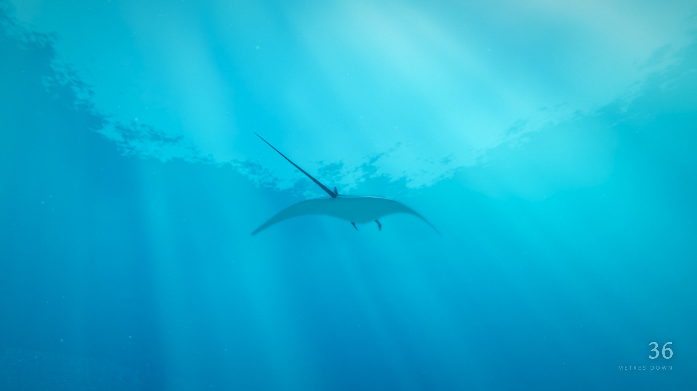
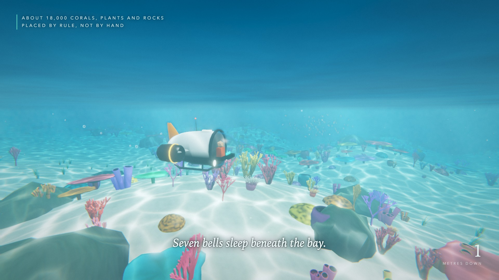
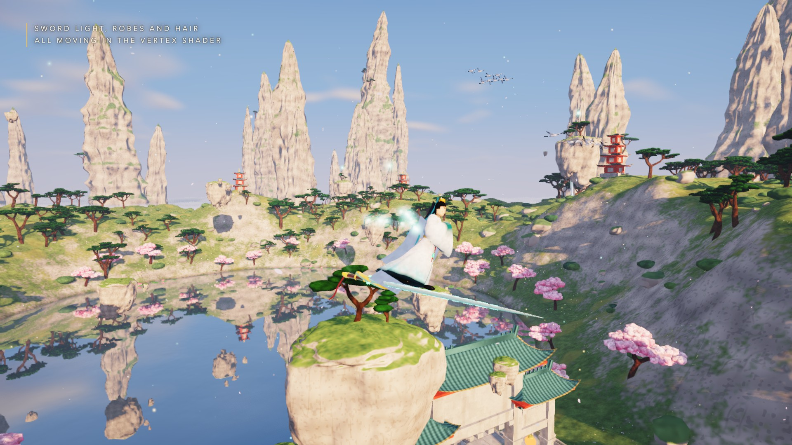
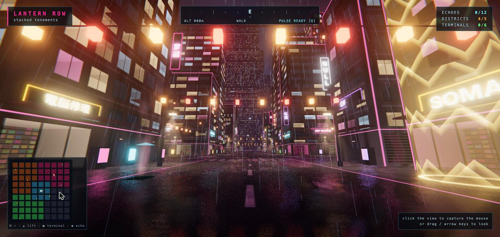
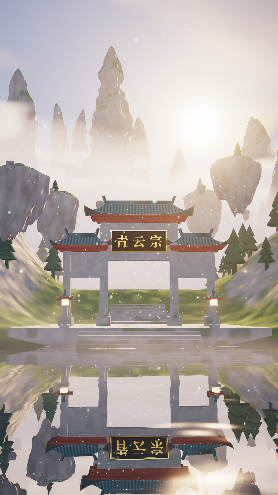

# Fable 5.2 Demo

**三句需求，原样呈现。其后的一切，皆由模型完成。**

这个仓库是一次 AI 模型能力展示的完整源码。三个浏览器里能直接玩的 3D 游戏，加一段 10 秒的渲染短片，全部由模型根据几句话的需求写成：代码、着色器、Blender 模型脚本、音效、自动化测试和宣传片渲染脚本都在这里。

- 没有下载任何图片、贴图、模型、字体、音乐或视频素材。
- 没有使用图像、视频或音频生成模型。
- 运行时只依赖 [three.js](https://threejs.org/) r170，其余全部手写。
- 每个游戏都打包成一个离线的 `index.html`，双击就能玩。

> 例外：后来加入的 [MISREMEMBER](#misremember) 不属于三句需求，它的贴图和照片是用 Codex 生成的图片，详见下文。

> 成片视频太大，没有放进仓库，请到 [Releases 页面](https://github.com/hahaliu1029/fable5.2demo/releases/tag/v1.0) 下载。



## 三句需求

| 顺序 | 需求原文 | 结果 |
|---|---|---|
| 第一句 | 「我想做一款水下探索游戏，而且要尽可能惊艳。」 | [Tidebell](#tidebell潮钟) |
| 第二句 | 「完成之后，用同样的方法，把原来文件夹里的仙侠游戏也打磨一遍。」 | [青云宗 · 御剑采灵](#青云宗--御剑采灵) |
| 第三句 | 「把赛博朋克那个也打磨一下，我想把它做成一款赛博城市里的驾驶游戏。」 | [MOTHLIGHT](#mothlight--vesper-9) |

第二句和第三句里的“原来的游戏”，是同一个模型在更早的任务里做的初版，也在这个仓库里。

## 项目一览

| 目录 | 内容 | 详细报告 |
|---|---|---|
| [`tidebell/`](tidebell/) | 水下探索游戏 | [`tidebell/README.md`](tidebell/README.md) |
| [`game/`](game/) | 仙侠御剑飞行游戏 | [`game/REPORT.md`](game/REPORT.md) |
| [`mothlight/`](mothlight/) | 赛博朋克城市驾驶游戏 | [`mothlight/REPORT.md`](mothlight/REPORT.md) |
| [`misremember/`](misremember/) | 第一人称记忆屋探索游戏（五晚中的前两晚） | [`misremember/README.md`](misremember/README.md) |
| 根目录 `src/`、`build.mjs`、`capture.mjs` | 10 秒竖屏短片《青云宗山门 · 破晓》 | [`REPORT.md`](REPORT.md) |
| [`fable-promo/`](fable-promo/) | 把三部宣传片剪成一部总片的脚本 | — |

每份报告都写了实现方法、验证方式、做了假的地方和模型自己评估的不足，值得一读。

### Tidebell（潮钟）



驾驶小潜水器，从阳光照透的珊瑚礁出发，穿过海带林和沉船，越过海崖进入深渊，沿途唤醒七口沉睡的潮钟。

- 48 个模型全部由 Blender 里的 Python 脚本生成：鱼、鲨、鮟鱇、鲸、蝠鲼、海龟、水母、珊瑚、沉船、鲸骨等。
- 手写的水下光照模型：光线按颜色随深度衰减，红色最先消失，开灯才能把颜色找回来；还有焦散、探照灯光锥、光柱和泛光。
- 海底约 18,000 个植物和岩石实例；鱼群和水母的动画完全在顶点着色器里完成。
- 操作：WASD 游动，鼠标看，Space / C 上浮下潜，Shift 加速，按住 E 唤醒潮钟，Q 声呐。

### 青云宗 · 御剑采灵



第三人称御剑飞行，在云海、浮岩和湖面之间收集 20 颗灵气，点亮山门牌匾后穿门通关。

- 体积云海、湖面真实平面反射和涟漪、日出光柱、太阳阴影。
- 打磨轮用 Blender 脚本重做了 14 个模型：御剑人物、松树、桃树、仙鹤、香炉、莲花和一条会盘绕湖面的龙。
- 水墨标题画面、飞剑光带、解锁时的金色光环和光柱。
- 支持键盘和触屏；自动驾驶脚本能完整通关并录制回放，结果可复现。

### MOTHLIGHT // Vesper-9



雨夜赛博城市里的街头竞速。按顺序穿过五个城区的 12 道光门，把散落的城市意识 LUMEN 带回中央尖塔。

- 种子生成的 9×9 街区城市：694 栋楼一次实例化绘制，窗户用内部映射画出带纵深的房间和店铺。
- 镜面湿街道、雨、霓虹招牌、单轨列车、行人和全息飞蛾。
- 驾驶版加入街机车辆物理、手刹漂移和加速，车身反射实时城市环境贴图，车灯照亮街面。
- 截图来自改成驾驶游戏之前的步行版本。

### MISREMEMBER

第一人称探索游戏。有什么东西按你的记忆重建了你童年的家，可记忆并不可靠。你看着的东西永远不会变，变化只发生在你身后。

目前完成了五个夜晚中的前两个：

1. **Almost**：晚饭。厨房会在你背后悄悄变样，多出一扇原本没有的门，有一面墙只有闭着眼才能穿过，还有一块一直走得很准的手表。
2. **Count**：门比昨天更多，而且都通向你的房间。主人一遍遍重数餐桌，储藏室只能倒着走进去，桌上有三个餐巾环。

- 房间和家具来自同一份 `data/house.json`。Blender 脚本据此建模，并给每个房间烘焙一张光照贴图；游戏也读这份文件。
- 每个房间有自己的坐标系。相邻房间按门对门接上，只透过门洞用模板遮罩（stencil）画出来，所以同一扇门下次打开可能通向别处。
- 会变的东西叫“漂移位”。变化先排队，等这个位置离开视野一段时间才落地；手表、餐巾环这类“锚点”会让相关的漂移位回到原样。
- 墙纸、地板、全家福和窗外景色是用 Codex 生成的图片，这一点和前三个项目不同。原始 PNG 没有放进仓库，仓库里只有转换后的 WebP。
- 操作：WASD 走，鼠标看，E 使用，按住 Space 闭眼，点头或摇头鼠标回答纸条（也可以按 Y / N）。

### 青云宗山门 · 破晓（短片）



10 秒、1080×1920、30 fps 的竖屏镜头推进。每一帧都是时间的纯函数，渲染结果完全可复现。

## 快速开始

直接玩：用桌面版 Chrome 打开 `tidebell/index.html`、`game/index.html`、`mothlight/index.html` 或 `misremember/index.html`。不需要安装任何东西，也不联网。

从源码重新构建：

```bash
cd tidebell        # 或 game、mothlight、misremember
npm install
npm run build      # 打包成 index.html
npm test           # 单元测试
npm run serve      # 本地服务（game 用 python3 -m http.server 8080）
```

重新生成模型（需要 Blender 5.2，默认路径 `/Applications/Blender.app`）：

```bash
npm run assets     # misremember 用 npm run house
```

MISREMEMBER 的 `npm run images` 需要原始 PNG，仓库里没有，所以直接用仓库里已有的 WebP 构建即可。

重新渲染短片（在仓库根目录）：

```bash
npm install && node build.mjs && node capture.mjs
```

## 环境要求

- Node.js 20.11 或更高（脚本用到了 `import.meta.dirname`）。
- 桌面版 Google Chrome，渲染和测试脚本默认用 macOS 路径，可以用 `CHROME=/path/to/chrome` 覆盖。
- 渲染视频需要 `ffmpeg`。
- 重建模型需要 Blender 5.2。

只玩游戏的话，上面这些都不需要。

## 视频

| 文件 | 内容 |
|---|---|
| [`fable-5.2-promo.mp4`](https://github.com/hahaliu1029/fable5.2demo/releases/download/v1.0/fable-5.2-promo.mp4) / [`fable-5.2-promo-zh.mp4`](https://github.com/hahaliu1029/fable5.2demo/releases/download/v1.0/fable-5.2-promo-zh.mp4) | 三部宣传片合成的总片（英文 / 中文） |
| [`tidebell-promo.mp4`](https://github.com/hahaliu1029/fable5.2demo/releases/download/v1.0/tidebell-promo.mp4) / [`tidebell-promo-zh.mp4`](https://github.com/hahaliu1029/fable5.2demo/releases/download/v1.0/tidebell-promo-zh.mp4) | Tidebell 宣传片 |
| [`qingyun-promo.mp4`](https://github.com/hahaliu1029/fable5.2demo/releases/download/v1.0/qingyun-promo.mp4) / [`qingyun-promo-zh.mp4`](https://github.com/hahaliu1029/fable5.2demo/releases/download/v1.0/qingyun-promo-zh.mp4) | 青云宗宣传片 |
| [`mothlight-promo.mp4`](https://github.com/hahaliu1029/fable5.2demo/releases/download/v1.0/mothlight-promo.mp4) / [`mothlight-promo-zh.mp4`](https://github.com/hahaliu1029/fable5.2demo/releases/download/v1.0/mothlight-promo-zh.mp4) | MOTHLIGHT 宣传片 |
| [`gameplay.mp4`](https://github.com/hahaliu1029/fable5.2demo/releases/download/v1.0/gameplay.mp4) | 青云宗自动通关的最后 15 秒 |
| [`scene.mp4`](https://github.com/hahaliu1029/fable5.2demo/releases/download/v1.0/scene.mp4) | 10 秒短片《青云宗山门 · 破晓》 |

宣传片都是用游戏本身逐帧渲染的：脚本控制镜头，物理、界面和配乐都来自游戏代码。下载地址见 [Releases 页面](https://github.com/hahaliu1029/fable5.2demo/releases/tag/v1.0)。

## 已知限制

- 只在一台 Apple M4 Max 的 Mac 上用 Chrome 测过。Firefox、Safari、真实手机和性能较弱的显卡都没验证。
- 招牌和界面里的中文用系统字体（宋体-简等），没有这些字体的机器会显示成别的字体。
- 各项目的具体缺陷写在各自报告的 “Missing or faked” 和 “My assessment of the weaknesses” 两节里。

## 许可证

[Apache-2.0](LICENSE)
